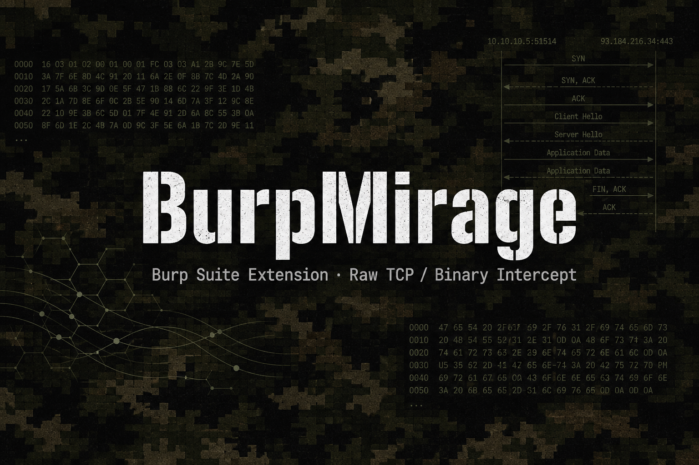

<p align="center">
  
</p>

<h1 align="center">BurpMirage</h1>

<p align="center">
  <strong>Windows raw TCP / 바이너리 트래픽을 Burp Suite에서 가로채는 Extension</strong><br />
  EchoMirage 스타일 Winsock 후킹 워크플로
</p>

<p align="center">
  <a href="https://github.com/KaiHT-Ladiant/BurpMirage/releases"></a>
  
  
  
</p>

<p align="center">
  <a href="./README.md">English</a> ·
  <a href="https://github.com/KaiHT-Ladiant/BurpMirage/releases">Releases</a> ·
  <a href="https://github.com/KaiHT-Ladiant/BurpMirage/releases/tag/v1.0.1-ko">한글 UI JAR</a> ·
  <a href="https://github.com/KaiHT-Ladiant/BurpMirage/releases/tag/v1.0.1-en">영문 UI JAR</a>
</p>

> **일반 사용자는 Python이나 Frida를 설치할 필요가 없습니다.** Releases JAR에는 `burpmirage-bridge.exe`(독립 실행형 네이티브 브릿지)가 포함되어 있습니다. JAR만 Burp에 로드하면 됩니다.

Windows 프로세스의 **raw TCP / 바이너리** 트래픽을 Burp에서 가로채고, Hex로 보고, 수정·전달할 수 있는 Extension입니다. Burp는 JVM이라 DLL을 직접 주입할 수 없기 때문에, Burp 옆에서 동작하는 **네이티브 브릿지**가 대상 프로세스에 후킹을 주입합니다.

```
┌──────────────────────────────┐
│  Burp Suite (Java / Montoya) │
│  Process / Intercept / Hex   │
│  History / Repeater / Settings│
└──────────────┬───────────────┘
               │ TCP JSON-lines (127.0.0.1:27042)
┌──────────────▼───────────────┐
│  burpmirage-bridge.exe       │  ← 릴리스 JAR에 포함
│  (독립 실행형 네이티브 호스트) │
└──────────────┬───────────────┘
               │ inject + IPC
┌──────────────▼───────────────┐
│  Target process              │
│  hooks.js → ws2_32 send/recv │
└──────────────────────────────┘
```

## 기능

- **프로세스 선택** — 실행 중 프로세스 목록 + **주입 & 후킹**
- **비 HTTP / 바이너리 프로토콜** — Hex dump 편집기 (ASCII 컬럼)
- **실시간 인터셉트** — 전달 / 드롭, 버퍼 인플레이스 수정
- **히스토리** — 수정 표시, 원본/수정본 보기, 컬럼 정렬
- **리피터** — 패킷 재주입 + 다음 RECV를 응답으로 페어링 (Request ID)
- **설정** — 브릿지 포트, 후킹 토글, 파일 로깅

## 요구 사항

| 구성 요소 | 비고 |
|-----------|------|
| Burp Suite | Montoya API (최근 Professional / Community) |
| OS | **Windows** |
| 권한 | 대상에 따라 관리자 권한 필요 |
| 아키텍처 | 64비트 브릿지는 32/64비트 대상 모두 attach 가능 |

**일반 사용 시 불필요:** Python, Frida, `pip install`. 소스 빌드나 선택적 Python 브릿지 폴백을 쓸 때만 필요합니다 ([개발자용](#개발자용) 참고).

## 빠른 시작

1. [Releases](https://github.com/KaiHT-Ladiant/BurpMirage/releases)에서 JAR 다운로드:
   - `burpmirage-1.0.1-ko.jar` — **한글 UI**
   - `burpmirage-1.0.1-en.jar` — 영문 UI
2. Burp: **Extensions → Add → Java** → JAR 선택  
   Extension class: `com.burpmirage.burp.BurpMirageExtension`
3. **BurpMirage** 탭 — 포함된 브릿지가 `127.0.0.1:27042`에서 수신
4. **프로세스 선택** — 새로고침 → 프로세스 선택 → **주입 & 후킹**
5. **트래픽 인터셉터** — 인터셉트 ON, Hex/ASCII 수정, 전달 또는 드롭
6. **히스토리** / **리피터**로 검토·재전송

브릿지가 시작되지 않으면 **설정 → 브릿지 EXE 경로**에 Releases의 `burpmirage-bridge.exe`(JAR에 내장된 것과 동일)를 지정하세요.

## 단축키 (트래픽 인터셉터)

인터셉터 패널에 포커스한 상태에서:

| 단축키 | 동작 |
|--------|------|
| **Ctrl+Shift+F** | 전달 (Forward) |
| **Ctrl+D** | 드롭 (Drop) |

> **참고:** `Ctrl+F`는 Burp가 사용하므로 Forward에 쓰지 않습니다.

## 탭

| 탭 | 용도 |
|----|------|
| 프로세스 선택 | 프로세스 목록 + 주입 & 후킹 / 분리 |
| 트래픽 인터셉터 | 실시간 인터셉트, Hex 편집, 전달 / 드롭 |
| 히스토리 | 패킷 로그, 수정 표시, 원본/수정본 보기 |
| 리피터 | Hex dump 요청 편집 + 응답 캡처 |
| 설정 | 브릿지 경로, 후킹, 로깅 |

## 개발자용

Extension 또는 독립 브릿지를 빌드하려면 **JDK 17+**와, 브릿지 패키징용 **Python 3.9+ (Frida 17+)** 가 필요합니다.

### JAR 빌드

```bash
./gradlew jarEn jarKo
```

산출물: `build/libs/burpmirage-1.0.0-en.jar`, `burpmirage-1.0.0-ko.jar`

Gradle이 JAR에 포함할 수 있도록 먼저 브릿지 exe를 빌드합니다:

```bash
packaging\build_bridge_exe.bat            REM PATH의 "python" 사용
packaging\build_bridge_exe.bat C:\경로\python.exe
```

산출물: `dist/burpmirage-bridge.exe` (Frida 내장 PyInstaller 번들). Gradle이 이를 JAR의 `frida/`에 복사합니다.

> exe는 대상과 동일한 OS/아키텍처에서 빌드하세요 (64비트 Windows 권장).

### 선택적 Python 브릿지 폴백

`burpmirage-bridge.exe`를 찾지 못하면 `src/main/resources/frida/frida_bridge.py`로 폴백할 수 있습니다:

```bash
pip install frida frida-tools
```

**설정 → Python 경로**에 `import frida` 가능한 `python.exe`를 지정하거나 **Python+Frida 탐지**를 사용하세요. 이 경로는 개발·트러블슈팅용이며, 릴리스 사용자는 내장 exe를 사용하면 됩니다.

## 트러블슈팅

| 증상 | 원인 |
|------|------|
| 브릿지 시작 실패 | **설정 → 브릿지 EXE 경로**에 Releases의 `burpmirage-bridge.exe` 지정 |
| 종료 코드 **9009** | Burp GUI PATH에 `python` 없음 — Python 폴백 대신 내장 브릿지 exe 사용 |
| hooks에서 `TypeError: not a function` | Frida 16 API — Frida **17+**로 브릿지 재빌드 |
| 브릿지 타임아웃 후 호스트 종료 | 소켓 connect timeout (최근 빌드에서 수정) |
| RECV 없음 / 리피터 응답 비어 있음 | 비동기 `WSARecv`(IOCP) 사용 가능 — 동기 `recv`/`WSARecv` 지원 |
| 주입 후 반응 없음 | 최근 소켓 없음 (`lastSocketFd`) — 트래픽 발생 후 Send |

## 제한 사항

- Overlapped / IOCP `WSARecv` 커버리지 제한
- TLS 평문 복호화 없음 (소켓 바이트만)
- 인플레이스 후킹은 원본 길이 초과 불가
- 보호/안티치트 프로세스는 attach 차단 가능

## 라이선스 / 사용 목적

본인 소유 또는 분석 권한이 있는 시스템에 대한 보안 연구·허가된 테스트용입니다.
