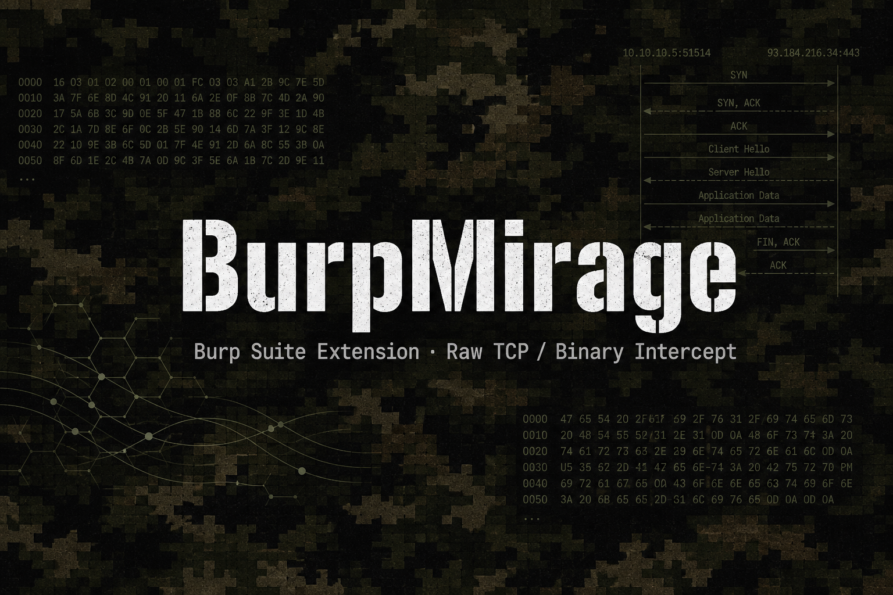

<p align="center">
  
</p>

<h1 align="center">BurpMirage</h1>

<p align="center">
  <strong>Burp Suite extension for raw TCP / binary intercept</strong><br />
  Winsock hooking on Windows — EchoMirage-style workflow inside Burp
</p>

<p align="center">
  <a href="https://github.com/KaiHT-Ladiant/BurpMirage/releases"></a>
  
  
  
</p>

<p align="center">
  <a href="./README.ko.md">한국어</a> ·
  <a href="https://github.com/KaiHT-Ladiant/BurpMirage/releases">Releases</a> ·
  <a href="https://github.com/KaiHT-Ladiant/BurpMirage/releases/tag/v1.0.1-ko">Korean UI JAR</a> ·
  <a href="https://github.com/KaiHT-Ladiant/BurpMirage/releases/tag/v1.0.1-en">English UI JAR</a>
</p>

> **End users do not install Python or Frida.** Download a release JAR — it bundles `burpmirage-bridge.exe`, a self-contained native bridge. Load the JAR in Burp and go.

BurpMirage intercepts, inspects, and modifies **raw TCP / binary** traffic from arbitrary Windows processes. Because Burp runs on the JVM and cannot inject DLLs directly, a small **native bridge** runs beside Burp and attaches hooks into the target process.

```
┌──────────────────────────────┐
│  Burp Suite (Java / Montoya) │
│  Process / Intercept / Hex   │
│  History / Repeater / Settings│
└──────────────┬───────────────┘
               │ TCP JSON-lines (127.0.0.1:27042)
┌──────────────▼───────────────┐
│  burpmirage-bridge.exe       │  ← bundled in release JAR
│  (standalone native host)    │
└──────────────┬───────────────┘
               │ inject + IPC
┌──────────────▼───────────────┐
│  Target process              │
│  hooks.js → ws2_32 send/recv │
└──────────────────────────────┘
```

## Features

- **Process selector** — list running processes (name, PID, path) and **Inject & Hook**
- **Non-HTTP / binary protocols** — Hex dump editor with ASCII column
- **Live intercept** — Forward / Drop with in-place buffer patching
- **History** — Edited marker, Original vs Edited view, column sorting
- **Repeater** — reinject packets and pair the next RECV as a response (Request ID)
- **Settings** — bridge port, hook toggles, file logging

## Requirements

| Component | Notes |
|-----------|--------|
| Burp Suite | Montoya API (recent Professional / Community) |
| OS | **Windows** |
| Privileges | Administrator may be required depending on the target |
| Architecture | 64-bit bridge attaches to both 32- and 64-bit targets |

**Not required for normal use:** Python, Frida, or `pip install`. Those are only needed if you build from source or run the optional Python bridge fallback (see [Developers](#developers)).

## Quick start

1. Download a release JAR from [Releases](https://github.com/KaiHT-Ladiant/BurpMirage/releases):
   - `burpmirage-1.0.1-en.jar` — English UI
   - `burpmirage-1.0.1-ko.jar` — Korean UI
2. In Burp: **Extensions → Add → Java** → select the JAR  
   Extension class: `com.burpmirage.burp.BurpMirageExtension`
3. Open the **BurpMirage** tab — the bundled bridge listens on `127.0.0.1:27042`.
4. **Process Selector** — refresh, pick a process → **Inject & Hook**.
5. **Traffic Interceptor** — toggle Intercept ON, edit hex/ASCII, Forward or Drop.
6. Use **History** / **Repeater** for review and replay.

If the bridge does not start, set **Settings → Bridge EXE path** to a standalone `burpmirage-bridge.exe` from Releases (same file that is embedded in the JAR).

## Keyboard shortcuts (Traffic Interceptor)

Focus the Interceptor panel (e.g. click the hex dump), then:

| Shortcut | Action |
|----------|--------|
| **Ctrl+Shift+F** | Forward |
| **Ctrl+D** | Drop |

> **Note:** `Ctrl+F` is reserved by Burp and is **not** used for Forward.

## Tabs

| Tab | Purpose |
|-----|---------|
| Process Selector | Process list + Inject & Hook / Detach |
| Traffic Interceptor | Live intercept, hex edit, Forward / Drop |
| History | Packet log, Edited flag, Original/Edited view |
| Repeater | Hex-dump request editor + response capture |
| Settings | Bridge path, hooks, logging |

## Developers

Building the extension or the standalone bridge requires **JDK 17+** and, for bridge packaging, a Python 3.9+ environment with Frida 17+.

### Build JARs

```bash
./gradlew jarEn jarKo
```

Artifacts: `build/libs/burpmirage-1.0.0-en.jar` and `burpmirage-1.0.0-ko.jar`

Build the bridge exe first so Gradle can bundle it:

```bash
packaging\build_bridge_exe.bat            REM uses "python" on PATH
packaging\build_bridge_exe.bat C:\path\to\python.exe
```

Output: `dist/burpmirage-bridge.exe` (PyInstaller bundle with Frida embedded). Gradle copies it into `frida/` inside the JAR.

> Build the exe on the same OS/architecture you target (64-bit Windows recommended).

### Optional Python bridge fallback

When no `burpmirage-bridge.exe` is found, the extension can fall back to `src/main/resources/frida/frida_bridge.py`:

```bash
pip install frida frida-tools
```

Set **Settings → Python path** to a `python.exe` that can `import frida`, or use **Detect Python+Frida**. This path is for development and troubleshooting — release users should rely on the bundled exe.

## Project layout

```
BurpMirage/
├── assets/cover.png
├── build.gradle.kts
├── packaging/                    # PyInstaller build for burpmirage-bridge.exe
│   ├── burpmirage_bridge.spec
│   └── build_bridge_exe.bat
└── src/
    ├── i18n/                     # en/ko UI strings (bundled per JAR)
    └── main/
        ├── java/com/burpmirage/burp/
        └── resources/frida/
            ├── hooks.js
            └── frida_bridge.py   # optional fallback host
```

## Troubleshooting

| Symptom | Likely cause |
|---------|----------------|
| Bridge fails to start | Point **Settings → Bridge EXE path** at `burpmirage-bridge.exe` from Releases |
| Exit code **9009** | Burp GUI PATH has no `python` — use the bundled bridge exe, not the Python fallback |
| hooks `TypeError: not a function` | Old Frida 16 APIs — rebuild bridge with Frida **17+** |
| Bridge `timed out` then host exits | Socket connect timeout (fixed in recent builds) |
| No RECV / empty Repeater response | App may use async `WSARecv` (IOCP); sync `recv` / `WSARecv` are supported |
| Inject does nothing | No recent socket (`lastSocketFd`); generate traffic first, then Send |

## Limitations

- Overlapped / IOCP `WSARecv` coverage is limited.
- TLS plaintext is not decrypted (socket ciphertext/bytes only).
- In-place hooks cannot grow buffers beyond the original length.
- Protected / anti-cheat processes may block attach.

## License / intended use

For security research and authorized testing on systems you own or have permission to analyze.
